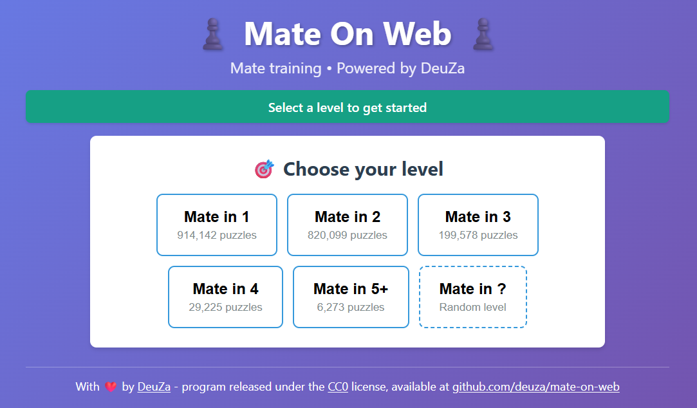
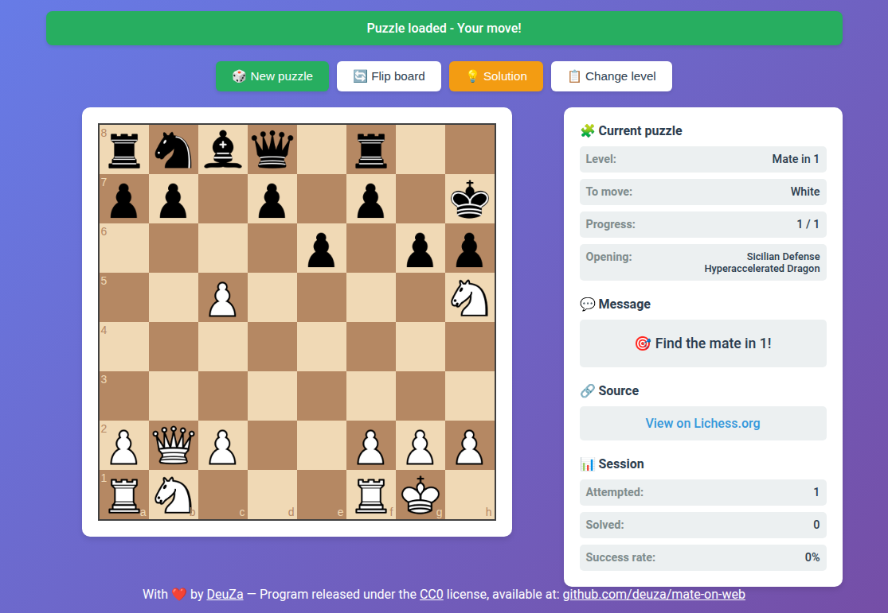
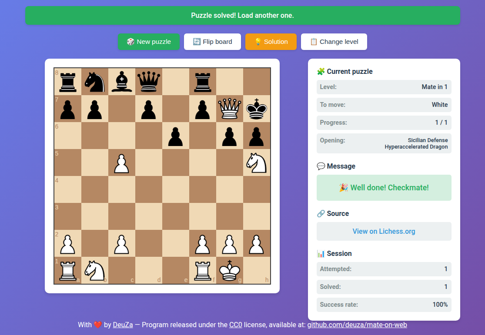
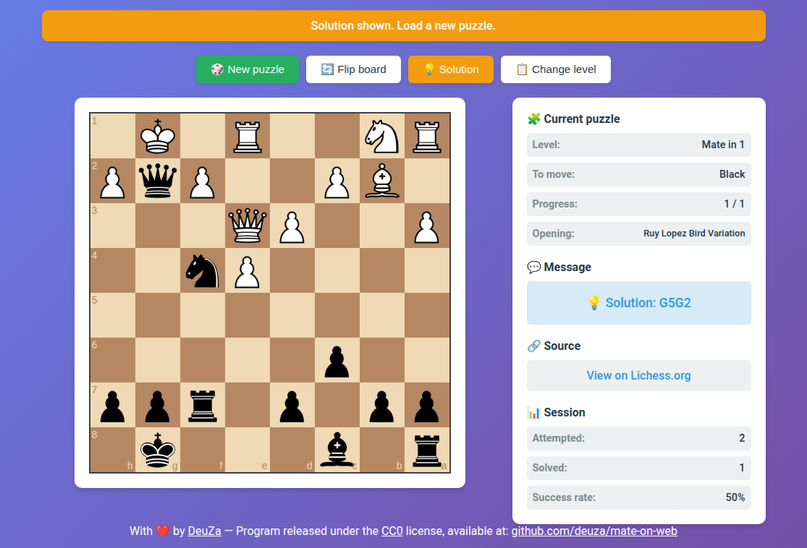

[](https://creativecommons.org/publicdomain/zero/1.0/deed.fr)
[](https://www.wtfpl.net/)


[](https://github.com/deuza/mate-on-web/commits/main)


[English](README.md) | **Français**

# ♟️ Mate On Web - Mat en X coups ♟️

Interface web d'entraînement aux problèmes de mat, alimentée par la base de données de Lichess.

> Ce document est la traduction française du [README en anglais](README.md), qui fait référence en cas de divergence. L'interface de l'application est en anglais : ses libellés sont cités tels qu'ils s'affichent à l'écran.

<p align="center">
  
  
  
  
</p>

---

## Table des matières

* [Installation rapide](#installation-rapide)

  * [1. Prérequis](#1-prérequis)
  * [2. Déploiement](#2-déploiement)
  * [3. Configuration du serveur web](#3-configuration-du-serveur-web)
  * [4. Accès](#4-accès)
* [Utilisation](#utilisation)

  * [Niveau Mate in 5+](#niveau-mate-in-5)
  * [Niveau mystère](#niveau-mystère)
  * [Recommencer un problème](#recommencer-un-problème)
  * [Raccourcis clavier](#raccourcis-clavier)
* [Mise à jour des problèmes](#mise-à-jour-des-problèmes)
* [Informations techniques](#informations-techniques)

  * [Structure des fichiers](#structure-des-fichiers)
  * [Format des fichiers CSV](#format-des-fichiers-csv)
  * [Notes techniques](#notes-techniques)
* [Ressources externes](#ressources-externes)
* [Anomalies connues](#anomalies-connues)
* [Historique des versions](#historique-des-versions)
* [Remerciements](#remerciements)
* [Licences](#licences)

## Installation rapide

### 1. Prérequis

Pour servir l'application :

* Un serveur web (Apache, nginx...) avec une version de PHP encore couverte par le support de sécurité (voir les [versions de PHP supportées](https://www.php.net/supported-versions.php)), testé avec PHP 8.4 sous Debian 13

Pour l'installer :

* git

Pour générer les problèmes :

* python3 avec le module `venv` (`python3-venv` sous Debian) : version 3.9 ou ultérieure, de préférence une version encore couverte par le support de sécurité (voir l'[état des versions de Python](https://devguide.python.org/versions/))
* wget
* zstd

Inutile d'installer python-chess au préalable : l'étape 2 l'installe dans un venv (environnement virtuel Python) dédié.

### 2. Déploiement

> Par simplicité, ces étapes clonent le projet dans la racine des documents du serveur web (`DocumentRoot`), où la configuration de l'étape 3 refuse l'accès au venv, aux scripts et au dump (l'export) de la base Lichess.
> Une organisation plus propre les garde ailleurs et lance la génération avec un utilisateur non privilégié, en ne laissant dans la racine des documents que les fichiers de l'application et les fichiers de problèmes générés : voir la section 4 de [docs/hardening.fr.md](docs/hardening.fr.md).

---

Placez-vous à la racine de votre serveur, ou dans le sous-répertoire de votre choix, pour y cloner le dossier qui hébergera l'application :

```
cd /var/www/html/
```

---

Clonez le dépôt :

```
git clone https://github.com/deuza/mate-on-web.git
```

Entrez dans le nouveau répertoire :

```
cd mate-on-web/
```

Créez l'environnement Python dans lequel installer python-chess, qui sert à calculer les positions FEN des problèmes. `requirements.txt` fixe sa version et son empreinte SHA-256, afin que `pip` refuse tout le reste :

```
python3 -m venv venv
source venv/bin/activate
pip install --require-hashes -r requirements.txt
deactivate
```

Téléchargez et extrayez les problèmes de Lichess en suivant les instructions du script :

```
./download_puzzles.sh
```

### 3. Configuration du serveur web

Avant d'ouvrir la page à d'autres, installez la configuration du serveur web fournie dans `docs/` : sans elle, le serveur sert `.git/`, `venv/`, les scripts et les fichiers de problèmes, et n'envoie aucun en-tête de sécurité. Avec Apache :

```
cp docs/apache2/mate-on-web.conf /etc/apache2/conf-available/mate-on-web.conf
a2enmod headers
a2enconf mate-on-web
apache2ctl configtest && systemctl reload apache2
```

L'équivalent pour nginx, la politique de sécurité du contenu (CSP), la limitation du débit et les vérifications à faire ensuite se trouvent dans [docs/hardening.fr.md](docs/hardening.fr.md).

### 4. Accès

Ouvrez dans un navigateur : `http://votre-serveur/mate-on-web/`

## Utilisation

1. **Choisissez un niveau** : Mate in 1, 2, 3 ou 4 (mat en 1, 2, 3 ou 4 coups), Mate in 5+ pour un mat en cinq coups ou plus, ou Mate in ? pour un niveau tiré au hasard (ces deux derniers niveaux sont expliqués plus bas)
2. **Jouez** : glissez-déposez une pièce, ou touchez-la (cliquez dessus) puis touchez sa case d'arrivée, pour trouver le mat
3. **Mauvais coup** : le coup est annulé, essayez-en un autre ou affichez la solution
4. **Bon coup** : l'adversaire répond automatiquement
5. **Problème terminé** (mat trouvé ou solution affichée) : recommencez le même problème depuis son début, ou chargez-en un nouveau (voir plus bas)

### Niveau Mate in 5+

Le niveau **Mate in 5+** correspond au thème Lichess "Mat en 5 ou plus" : l'outil d'étiquetage de Lichess y range tous les mats en cinq coups ou plus, et `mat5.csv` le reprend en entier. Dans le dump de novembre 2026, un problème sur quatre de ce niveau demande six coups ou plus, jusqu'à onze.

La zone de jeu indique donc la longueur réelle de chaque problème, comptée sur sa solution, plutôt que le numéro du bouton : la ligne Level (niveau), le message "Find the mate in ..." (trouvez le mat en ...) et le total du compteur de progression peuvent afficher 7 pour un problème tiré du niveau Mate in 5+. Les niveaux 1 à 4 contiennent des longueurs exactes : les deux nombres y sont donc identiques.

### Niveau mystère

Le bouton **Mate in ?** tire au hasard le niveau de chaque problème parmi les niveaux disponibles :

* Chaque niveau a la même chance de sortir (une sur cinq avec les cinq fichiers), quel que soit son nombre de problèmes
* Chaque tirage est indépendant des précédents, le même niveau peut donc sortir deux fois de suite : la séquence ne trahit rien
* Le niveau, le total du compteur de progression et le lien vers Lichess restent masqués jusqu'à ce que le mat soit trouvé ou la solution affichée. La longueur réelle du mat est alors révélée, comptée sur la solution comme pour les autres niveaux : un problème tiré au niveau 5 peut se révéler être un mat en 6 coups ou plus (voir [Niveau Mate in 5+](#niveau-mate-in-5))

Le tirage a lieu dans le navigateur : `puzzle.php` reçoit un niveau ordinaire et choisit le problème comme d'habitude. Le bouton n'apparaît que si au moins deux fichiers de problèmes existent.

### Recommencer un problème

Une fois le problème terminé, mat trouvé ou solution déroulée jusqu'au bout, le bouton **Retry** (réessayer), ou la touche `R`, le relance depuis sa position de départ, pour rejouer la ligne :

* Retry n'apparaît qu'une fois le problème terminé. Un mauvais coup n'a pas besoin de bouton : il est annulé aussitôt, et le joueur reste sur le même coup de la ligne
* Le problème n'est pas rechargé (aucune requête au serveur), et l'échiquier garde son orientation
* Rejouer un problème ne change ni le nombre de problèmes tentés ni le nombre de problèmes résolus : le mat d'une reprise n'est jamais compté, un problème dont la solution a été affichée ne peut donc pas être compté comme résolu en le rejouant
* En mode mystère, le niveau révélé à la fin du problème reste affiché pendant la reprise

### Raccourcis clavier

* `N` : nouveau problème
* `F` : tourner l'échiquier
* `S` : afficher la solution
* `R` : recommencer le problème depuis son début, une fois celui-ci terminé
* `Esc` (Échap) : annuler la promotion, ou la pièce sélectionnée en la touchant (ou d'un clic)

Les raccourcis sont ignorés tant que Ctrl, Alt ou Cmd est enfoncé, pour que les raccourcis propres au navigateur continuent de fonctionner.

## Mise à jour des problèmes

Placez-vous dans le répertoire où le projet est cloné :

```
cd /var/www/html/mate-on-web/
```

Téléchargez et extrayez les nouveaux problèmes de Lichess :

```
./download_puzzles.sh
```

Le script écrit aussi le nombre de lignes de chaque `matN.csv` dans `matN.count`, que `index.php` lit au lieu de parcourir tout le fichier à chaque chargement de la page. Avec l'organisation de la section 4 de [docs/hardening.fr.md](docs/hardening.fr.md), copiez ensuite les nouveaux fichiers à côté des fichiers PHP, comme décrit dans cette section.

Si vous régénérez un CSV à la main avec `extract.py`, mettez aussi son décompte à jour (`wc -l < mat1.csv > mat1.count`) ou supprimez le fichier `.count` : un décompte plus ancien que son CSV est ignoré, et les lignes sont alors recomptées.

## Informations techniques

### Structure des fichiers

```
mate-on-web/
├── .gitignore              # Fichiers de problèmes générés, dump Lichess et venv, exclus de git
├── CHANGELOG.md            # Changements notables de chaque version (en anglais)
├── LICENSE                 # Creative Commons Zero v1.0 Universal
├── LICENSE-WTFPL           # What The Fuck Public License
├── README.md               # Ce document, en anglais
├── README.fr.md            # Ce document, en français
├── app.js                  # Logique du jeu en JavaScript
├── chess.js                # Bibliothèque chess.js (copie locale)
├── docs/                   # Notes de durcissement (en anglais et en français), configurations Apache et nginx
├── download_puzzles.sh     # Script de téléchargement depuis Lichess
├── extract.py              # Script d'extraction des problèmes (joue le 1er coup)
├── favicon.ico             # Icône de l'application
├── index.php               # Interface principale
├── puzzle.php              # API JSON (charge un problème au hasard)
├── requirements.txt        # python-chess, version et empreinte SHA-256 fixées
├── screenshots/            # Captures d'écran du README
├── style.css               # Styles CSS
├── vendor/                 # Fichiers tiers embarqués : jQuery, chessboard.js, images des pièces, SHA256SUMS
├──
├── mat1.csv                # Problèmes de mat en 1 (à générer)
├── mat2.csv                # Problèmes de mat en 2 (à générer)
├── mat3.csv                # Problèmes de mat en 3 (à générer)
├── mat4.csv                # Problèmes de mat en 4 (à générer)
├── mat5.csv                # Problèmes de mat en 5 ou plus (à générer)
├──
└── matN.count              # Nombre de lignes de chaque matN.csv (généré avec lui, lu par index.php)
```

### Format des fichiers CSV

```
PuzzleId,FEN,Solution,URL,OpeningTags,DailyDate
000rZ,2kr1b1r/p1p2pp1/...,d6h2,https://lichess.org/...,Scandinavian_Defense,
```

* **PuzzleId** : identifiant unique attribué par Lichess
* **FEN** : position après le coup de l'adversaire (le joueur doit trouver le mat)
* **Solution** : coups en notation UCI, séparés par des espaces
* **URL** : lien vers le problème sur Lichess
* **OpeningTags** : ouverture(s) associée(s)
* **DailyDate** : horodatage Unix en millisecondes si le problème a été le problème du jour de Lichess, vide sinon (inutilisé par l'application)

### Notes techniques

* L'échiquier est orienté automatiquement selon le camp au trait
* Les écrans tactiles sont pris en charge : une pièce peut être glissée du doigt, ou touchée puis sa case d'arrivée touchée (cela fonctionne aussi d'un clic de souris)
* La promotion du pion propose Dame, Tour, Fou ou Cavalier (Queen, Rook, Bishop et Knight dans l'interface)
* Tout coup qui donne mat résout le problème, comme sur Lichess, même s'il ne s'agit pas du mat de la solution Lichess (certains problèmes ont plusieurs mats au dernier coup, promotion en une autre pièce comprise) ; tout autre coup doit correspondre à la solution
* Les statistiques de session sont conservées en mémoire uniquement (aucune persistance)
* Aucun accès réseau n'est nécessaire à l'exécution : jQuery, chessboard.js et les images des pièces sont embarqués dans `vendor/` (voir `vendor/README.md`), l'application fonctionne donc hors ligne une fois les problèmes générés
* Un problème est tiré au hasard en temps constant (positionnement à un décalage aléatoire dans le CSV), quelle que soit la taille du fichier

## Ressources externes

* **Base de données Lichess** : https://database.lichess.org/
* **Documentation de python-chess** : https://python-chess.readthedocs.io/
* **Notation UCI** : https://www.chessprogramming.org/UCI
* **Ancienne version en ligne de commande** : [mat-en](https://github.com/deuza/mat-en/)

## Anomalies connues

* Aucune connue à ce jour

## Historique des versions

Les changements notables de chaque version sont listés dans [CHANGELOG.md](CHANGELOG.md), en anglais. Les versions suivent la [gestion sémantique de version](https://semver.org/lang/fr/) : une nouvelle version majeure signifie qu'une installation existante demande une intervention de son administrateur après la mise à jour.

## Remerciements

* Problèmes : [Lichess.org](https://lichess.org/), base de données ouverte
* Échiquier : [chessboard.js](https://chessboardjs.com/) (MIT) avec [jQuery](https://jquery.com/) (MIT)
* Images des pièces : jeu d'échecs Wikipédia de Colin M.L. Burnett (GFDL / CC BY-SA 3.0 / BSD), tel que fourni avec chessboard.js
* Logique : [chess.js](https://github.com/jhlywa/chess.js)
* Version en ligne de commande : [mat-en](https://github.com/deuza/mat-en/)

## Licences

Projet sous double licence

* [**CC0 1.0 Universel**](https://creativecommons.org/publicdomain/zero/1.0/deed.fr) - Pas de droit d'auteur
* [**WTFPL**](https://www.wtfpl.net/) - Do What The Fuck You Want To Public License

---

*Bon jeu !*

<p align="center">Maintenu avec ❤️ par <a href="https://github.com/deuza">DeuZa</a></p>
