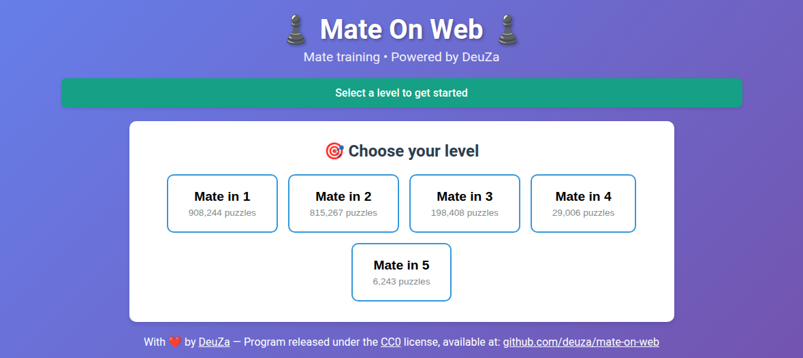
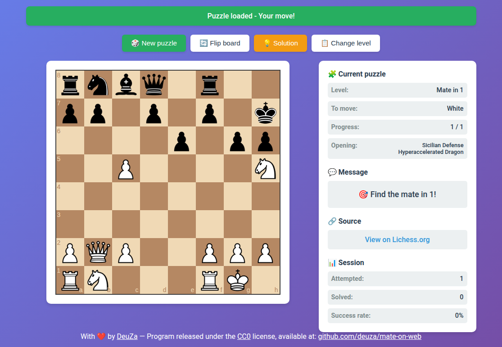
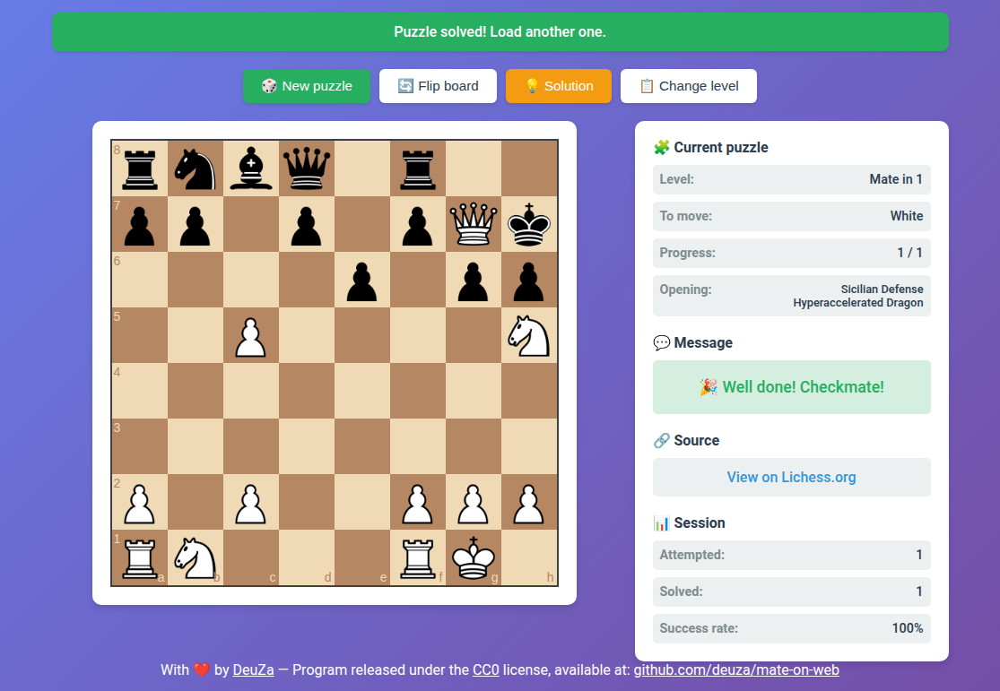
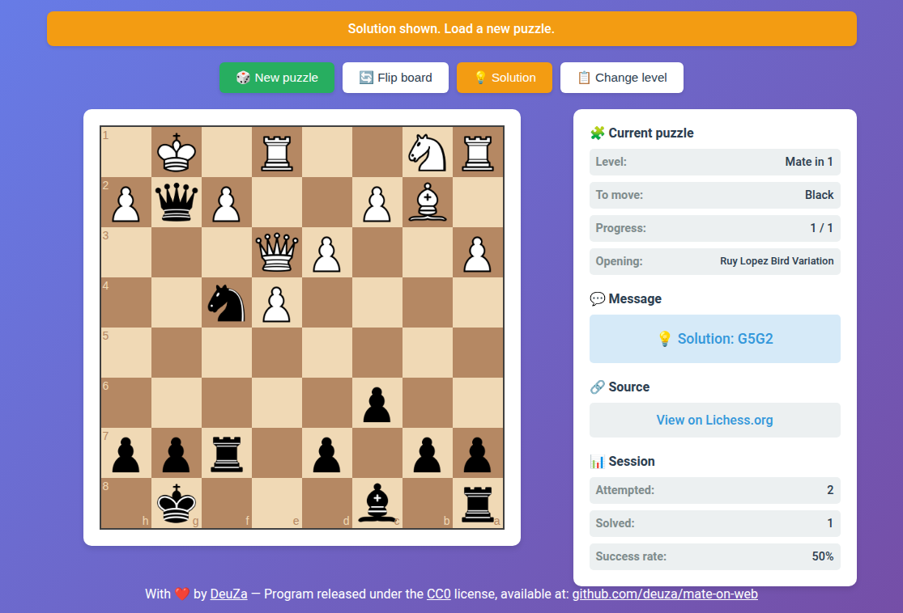

[](https://github.com/deuza/mat-on-web/commits/main)

[](https://github.com/deuza/mate-on-web/commits/main)

[](https://www.wtfpl.net/)
[](https://creativecommons.org/publicdomain/zero/1.0/)


# ♟️ Mat On Web - Mate in X moves ♟️

Mate puzzle training web interface, powered by the Lichess database.

<p align="center">
  
  
  
  
</p>

---

## Table of contents

* [♟️ Mat On Web - Mate in X moves ♟️](#️-mat-on-web---mate-in-x-moves)

  * [Table of contents](#table-of-contents)
  * [Quick install](#quick-install)

    * [1. Prerequisites](#1-prerequisites)
    * [2. Deployment](#2-deployment)
    * [3. Access](#3-access)
  * [File structure](#file-structure)
  * [Usage](#usage)

    * [Keyboard shortcuts](#keyboard-shortcuts)
    * [4. Upgrading the puzzles](#4-upgrading-the-puzzles)
    * [5. Technical information](#5-technical-information)
  * [CSV file format](#csv-file-format)
  * [Technical notes](#technical-notes)
  * [External resources](#external-resources)
  * [Known issues](#known-issues)

    * [6. Acknowledgements](#6-acknowledgements)
    * [7. Licenses](#7-licenses)

## Quick install

### 1. Prerequisites

* A web server with PHP 7.4+ (Apache, Nginx...)
* Python 3 with `python-chess` (to generate the puzzles)
* git version 2.39.5

To generate the puzzles:

* wget | GNU Wget 1.21.3 built on linux-gnu.
* zstd | Zstandard CLI (64-bit) v1.5.4, by Yann Collet
* python3 | Python 3.11.2

### 2. Deployment

> Clone outside your `DocumentRoot` if you do not want the `venv` or the .sh script in there.     
> You can simply move them there afterwards.

---

Go to your server's root directory, or to the subdirectory of your choice, to clone the folder hosting the application

```
cd /var/www/html/
```

---

Clone the repository :

```
git clone https://github.com/deuza/mat-on-web.git
```

Go to the new directory :

```
cd mat-on-web/
```

Create the Python environment to install python-chess, which is used to generate the FEN positions of the puzzles :

```
python3 -m venv venv 
source venv/bin/activate
pip install python-chess
deactivate
```

Download and extract the Lichess puzzles by following the instructions in the script :


```
./download_puzzles.sh
```

### 3. Access

Open in a browser : `http://your-server/mate-on-web/`

## File structure

```
mate-on-web/
├── LICENSE                 # Creative Commons Zero v1.0 Universal
├── LICENSE-WTFPL           # What The Fuck Public License
├── README.md               # This file
├── app.js                  # JavaScript game logic
├── chess.js                # chess.js library (local copy)
├── download\_puzzles.sh    # Lichess download script
├── extract.py              # Puzzle extraction script (plays the 1st move)
├── favicon.ico             # Application icon
├── index.php               # Main interface
├── puzzle.php              # JSON API (loads a random puzzle)
├── screenshots/            # README screenshots
├── style.css               # CSS styles
├── tools/                  # make-screenshots.py (regenerates the screenshots, Playwright)
├── vendor/                 # Bundled third-party files: jQuery, chessboard.js, piece images
├── 
├── mat1.csv                # Mate-in-1 puzzles (to be generated)
├── mat2.csv                # Mate-in-2 puzzles (to be generated)
├── mat3.csv                # Mate-in-3 puzzles (to be generated)
├── mat4.csv                # Mate-in-4 puzzles (to be generated)
├── mat5.csv                # Mate-in-5 puzzles (to be generated)
├── 
└── matN.count              # Line count of each matN.csv (generated with it, read by index.php)
```

## Usage

1. **Select a level** : Mate in 1, 2, 3, 4 or 5 moves
2. **Play** : Drag and drop the pieces to find the mate
3. **Wrong move** : Retry or show the solution
4. **Right move** : The opponent replies automatically
5. **Mate found** : Load a new puzzle

### Keyboard shortcuts

* `N`: New puzzle
* `F`: Flip the board
* `S`: Show the solution
* `Esc`: Cancel the promotion

The shortcuts are ignored while Ctrl, Alt or Cmd is held, so the browser's own shortcuts keep working.

### 4. Upgrading the puzzles

Go to the directory containing the exercises :

```
cd /var/www/html/mate-on-web/
```

Download and extract the new Lichess puzzles :

```
./download_puzzles.sh
```

The script also writes the line count of each `matN.csv` into `matN.count`, which `index.php` reads instead of scanning the whole file on every page load.    
If you regenerate a CSV by hand with `extract.py`, refresh its count too (`wc -l < mat1.csv > mat1.count`) or delete the `.count` file : a count older than its CSV is ignored and the lines are counted again.

### 5. Technical information

## CSV file format

```
PuzzleId,FEN,Solution,URL,OpeningTags,DailyDate
000rZ,2kr1b1r/p1p2pp1/...,d6h2,https://lichess.org/...,Scandinavian_Defense,
```

* **PuzzleId**    : Unique Lichess identifier
* **FEN**         : Position after the opponent's move (the player has to find the mate)
* **Solution**    : Moves in UCI notation, separated by spaces
* **URL**         : Link to the puzzle on Lichess
* **OpeningTags** : Associated opening(s)
* **DailyDate**   : Unix timestamp in milliseconds if the puzzle was featured as the Lichess daily puzzle, empty otherwise (not used by the application)

## Technical notes

* The board is automatically oriented according to the side to move
* Pawn promotion offers a choice between Queen, Rook, Bishop and Knight
* Session stats are kept in memory only (no persistence)
* No network access needed at runtime: jQuery, chessboard.js and the piece images are bundled in `vendor/` (see `vendor/README.md`), so the application runs offline once the puzzles are generated
* A random puzzle is picked in constant time (seek to a random offset in the CSV), whatever the file size

## External resources

* **Lichess database** : https://database.lichess.org/
* **python-chess doc** : https://python-chess.readthedocs.io/
* **UCI notation**     : https://www.chessprogramming.org/UCI
* **old CLI version**  : [mat-en](https://github.com/deuza/mat-en/)

## Known issues

* Use on touch screens

### 6. Acknowledgements

* Puzzles : [Lichess.org](https://lichess.org/) - Open database
* Board : [chessboard.js](https://chessboardjs.com/) (MIT) with [jQuery](https://jquery.com/) (MIT)
* Piece images : Colin M.L. Burnett's Wikipedia chess set (GFDL / CC BY-SA 3.0 / BSD), as shipped with chessboard.js
* Logic : [chess.js](https://github.com/jhlywa/chess.js)
* CLI version : [mat-en](https://github.com/deuza/mat-en/)

### 7. Licenses

Dual-Licensed Project

* [**CC0 1.0 Universel**](https://creativecommons.org/publicdomain/zero/1.0/) — No Copyright
* [**WTFPL**](http://www.wtfpl.net/) — Do What The Fuck You Want To Public License

---

*Enjoy the game !*

<p align="center">Maintened with ❤️ by <a href="https://github.com/deuza">DeuZa</a></p></sup></sub>

