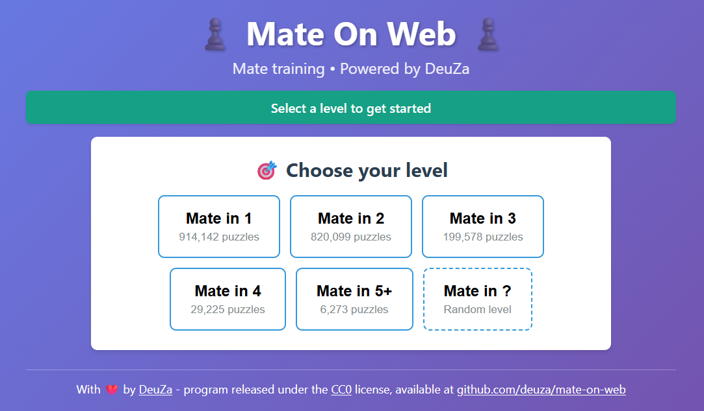
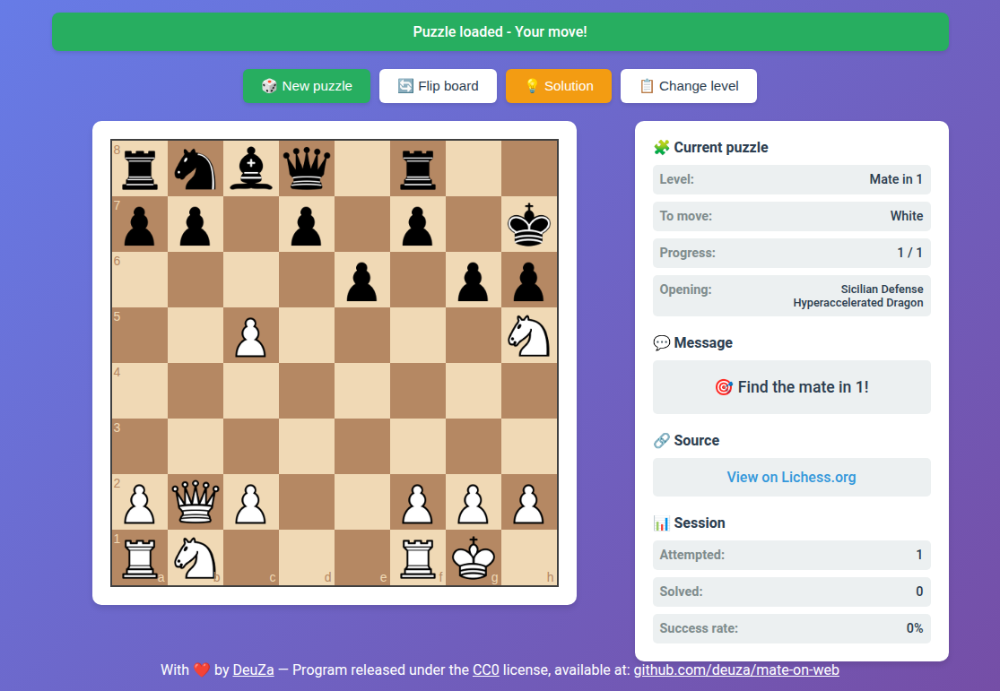
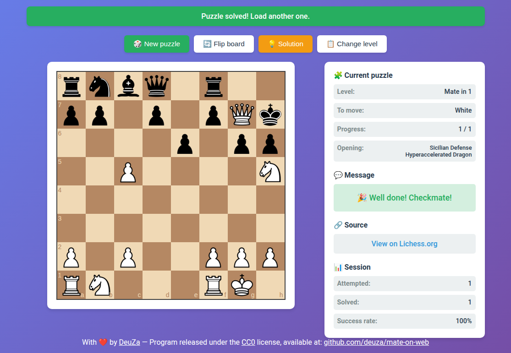
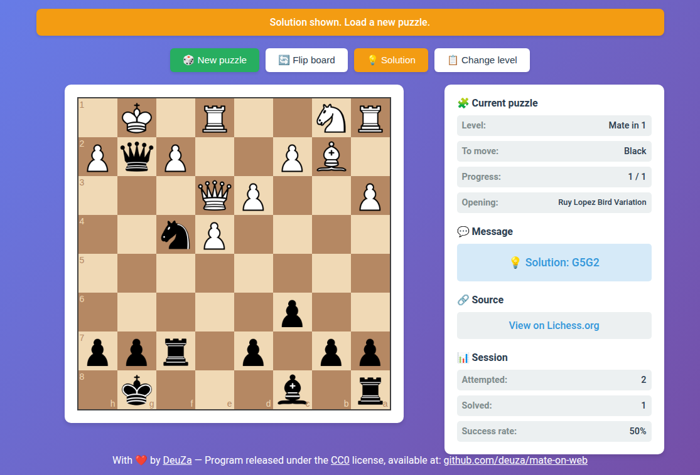

[](https://creativecommons.org/publicdomain/zero/1.0/)
[](https://www.wtfpl.net/)


[](https://github.com/deuza/mate-on-web/commits/main)


**English** | [Français](README.fr.md)

# ♟️ Mate On Web - Mate in X moves ♟️

Mate puzzle training web interface, powered by the Lichess database.

<p align="center">
  
  
  
  
</p>

---

## Table of contents

* [Quick install](#quick-install)

  * [1. Prerequisites](#1-prerequisites)
  * [2. Deployment](#2-deployment)
  * [3. Web server configuration](#3-web-server-configuration)
  * [4. Access](#4-access)
* [Usage](#usage)

  * [Mate in 5+](#mate-in-5)
  * [Mystery level](#mystery-level)
  * [Retry](#retry)
  * [Keyboard shortcuts](#keyboard-shortcuts)
* [Updating the puzzles](#updating-the-puzzles)
* [Technical information](#technical-information)

  * [File structure](#file-structure)
  * [CSV file format](#csv-file-format)
  * [Technical notes](#technical-notes)
* [External resources](#external-resources)
* [Known issues](#known-issues)
* [Changelog](#changelog)
* [Acknowledgements](#acknowledgements)
* [Licenses](#licenses)

## Quick install

### 1. Prerequisites

To serve the application:

* A web server (Apache, nginx...) with a PHP release still in security support (see the [supported PHP versions](https://www.php.net/supported-versions.php)), tested with PHP 8.4 on Debian 13

To install it:

* git

To generate the puzzles:

* python3 with the `venv` module (`python3-venv` on Debian): 3.9 or later, preferably a release still in security support (see the [status of the Python versions](https://devguide.python.org/versions/))
* wget
* zstd

python-chess needs no prior installation: step 2 installs it in a dedicated venv.

### 2. Deployment

> For simplicity, these steps clone the project into the document root, where the web server configuration of step 3 refuses the venv, the scripts and the Lichess dump.
> A cleaner layout keeps them elsewhere and runs the generation as an unprivileged user, with only the application files and the generated puzzle files in the document root: see section 4 of [docs/hardening.md](docs/hardening.md).

---

Go to your server's root directory, or to the subdirectory of your choice, to clone the folder hosting the application:

```
cd /var/www/html/
```

---

Clone the repository:

```
git clone https://github.com/deuza/mate-on-web.git
```

Go to the new directory:

```
cd mate-on-web/
```

Create the Python environment to install python-chess, which is used to generate the FEN positions of the puzzles. `requirements.txt` pins its version and its SHA-256 hash, so that `pip` refuses anything else:

```
python3 -m venv venv
source venv/bin/activate
pip install --require-hashes -r requirements.txt
deactivate
```

Download and extract the Lichess puzzles by following the instructions in the script:

```
./download_puzzles.sh
```

### 3. Web server configuration

> **If the application can be reached from the Internet, this step is mandatory.**
> Cloning the repository does not apply the configuration shipped in `docs/`: as long as it is not installed in the web server, anyone can download `.git/`, `venv/`, the scripts and the puzzle files (`mat1.csv` alone weighs more than 100 MB), and the page is sent without its content security policy. Only an installation that nobody else can reach (your own machine, a private network) can do without it.

Before opening the page to others, install the web server configuration shipped in `docs/`: without it, the server serves `.git/`, `venv/`, the scripts and the puzzle files, and sends no security header. With Apache:

```
cp docs/apache2/mate-on-web.conf /etc/apache2/conf-available/mate-on-web.conf
a2enmod headers
a2enconf mate-on-web
apache2ctl configtest && systemctl reload apache2
```

Then check the result from another machine, against the public address, with the commands of section 8 of [docs/hardening.md](docs/hardening.md): the refused paths must answer 403, and the `Content-Security-Policy` header must be sent once, with the value of the shipped file. If it is missing, comes twice or has another value, the configuration is not applied, or another configuration file of the web server sets the same header (see the Apache notes of section 6). Run these checks again after any change to the web server configuration.

The nginx equivalent, the content security policy and rate limiting are in [docs/hardening.md](docs/hardening.md).

### 4. Access

Open in a browser: `http://your-server/mate-on-web/`

## Usage

1. **Select a level**: Mate in 1, 2, 3 or 4 moves, Mate in 5+ for five moves or more, or Mate in ? for a random level (both explained below)
2. **Play**: Drag and drop a piece, or tap (click) it and then its destination, to find the mate
3. **Wrong move**: The move is taken back, try another one or show the solution
4. **Right move**: The opponent replies automatically
5. **Puzzle over** (mate found or solution shown): Retry the same puzzle from its start, or load a new one (see below)

### Mate in 5+

The **Mate in 5+** level is the Lichess theme "Mate in 5 or more": the Lichess tagger files every mate of five moves or longer under it, and `mat5.csv` keeps it whole. In the dump of November 2026, one puzzle in four of that level takes six moves or more, up to eleven.

The game area therefore gives the real length of each puzzle, counted on its solution, rather than the number of the button: the Level line, the "Find the mate in ..." message and the total of the progress counter can say 7 for a puzzle drawn from Mate in 5+. Levels 1 to 4 hold exact lengths, so both numbers are the same there.

### Mystery level

The **Mate in ?** button draws the level of each puzzle at random among the available levels:

* Each level has the same chance (one in five with the five files), whatever its number of puzzles
* Each draw is independent of the previous ones, so the same level can come twice in a row: the sequence gives nothing away
* The level, the total of the progress counter and the Lichess link stay hidden until the mate is found or the solution is shown, then the real length of the mate is revealed, counted on the solution as on the other levels: a puzzle drawn at level 5 can turn out to be a mate in 6 or more (see [Mate in 5+](#mate-in-5))

The draw is made in the browser: `puzzle.php` receives an ordinary level and picks the puzzle as usual. The button only appears when at least two puzzle files exist.

### Retry

Once a puzzle is over, the mate found or the solution shown to the end, the **Retry** button (or the `R` key) restarts it from its starting position, to play the line again:

* Retry only appears once the puzzle is over. A wrong move needs no button: it is taken back at once, and the player stays on the same move of the line
* The puzzle is not loaded again (no request to the server), and the board keeps its orientation
* A replay changes neither the number of puzzles attempted nor the number solved: the mate of a replay is never counted, so a puzzle whose solution was shown cannot be counted as solved by replaying it
* In mystery mode, the level revealed at the end of the puzzle stays shown during the replay

### Keyboard shortcuts

The board is played with a pointing device (mouse, touchpad) or with a finger on a touch screen: a move cannot be entered from the keyboard. The shortcuts come in addition to the buttons:

* `N`: New puzzle
* `F`: Flip the board
* `S`: Show the solution
* `R`: Retry the puzzle from its start, once it is over
* `Esc`: Cancel the promotion, or the piece selected by a tap (click)

The shortcuts are ignored while Ctrl, Alt or Cmd is held, so the browser's own shortcuts keep working.

## Updating the puzzles

Go to the directory where the project is cloned:

```
cd /var/www/html/mate-on-web/
```

Download and extract the new Lichess puzzles:

```
./download_puzzles.sh
```

The script also writes the line count of each `matN.csv` into `matN.count`, which `index.php` reads instead of scanning the whole file on every page load. With the layout of section 4 of [docs/hardening.md](docs/hardening.md), copy the new files next to the PHP files afterwards, as described there.

If you regenerate a CSV by hand with `extract.py`, refresh its count too (`wc -l < mat1.csv > mat1.count`) or delete the `.count` file: a count older than its CSV is ignored and the lines are counted again.

## Technical information

### File structure

```
mate-on-web/
├── .gitignore              # Generated puzzle files, Lichess dump and venv, kept out of git
├── CHANGELOG.md            # Notable changes of each release
├── LICENSE                 # Creative Commons Zero v1.0 Universal
├── LICENSE-WTFPL           # What The Fuck Public License
├── README.md               # This file
├── README.fr.md            # This file, in French
├── app.js                  # JavaScript game logic
├── chess.js                # chess.js library (local copy)
├── docs/                   # Hardening notes (in English and in French), Apache and nginx configuration
├── download_puzzles.sh     # Lichess download script
├── extract.py              # Puzzle extraction script (plays the 1st move)
├── favicon.ico             # Application icon
├── index.php               # Main interface
├── puzzle.php              # JSON API (loads a random puzzle)
├── requirements.txt        # python-chess, pinned version and SHA-256 hash
├── screenshots/            # README screenshots
├── style.css               # CSS styles
├── vendor/                 # Bundled third-party files: jQuery, chessboard.js, piece images, SHA256SUMS
├──
├── mat1.csv                # Mate-in-1 puzzles (to be generated)
├── mat2.csv                # Mate-in-2 puzzles (to be generated)
├── mat3.csv                # Mate-in-3 puzzles (to be generated)
├── mat4.csv                # Mate-in-4 puzzles (to be generated)
├── mat5.csv                # Mate-in-5-or-more puzzles (to be generated)
├──
└── matN.count              # Line count of each matN.csv (generated with it, read by index.php)
```

### CSV file format

```
PuzzleId,FEN,Solution,URL,OpeningTags,DailyDate
000rZ,2kr1b1r/p1p2pp1/...,d6h2,https://lichess.org/...,Scandinavian_Defense,
```

* **PuzzleId**: Unique Lichess identifier
* **FEN**: Position after the opponent's move (the player has to find the mate)
* **Solution**: Moves in UCI notation, separated by spaces
* **URL**: Link to the puzzle on Lichess
* **OpeningTags**: Associated opening(s)
* **DailyDate**: Unix timestamp in milliseconds if the puzzle was featured as the Lichess daily puzzle, empty otherwise (not used by the application)

`puzzle.php` reads the fields by their position, the PuzzleId first. The `--no_id` option of `extract.py`, kept from the command-line version ([mat-en](https://github.com/deuza/mat-en/)), leaves that field out: a file written with it cannot be served by the application, do not use it for the `matN.csv` files.

### Technical notes

* The board is automatically oriented according to the side to move
* Touch screens are supported: a piece can be dragged with a finger, or tapped and then its destination tapped (the same works with a mouse click)
* Pawn promotion offers a choice between Queen, Rook, Bishop and Knight
* Any move that gives checkmate solves the puzzle, as on Lichess, even when it is not the mate of the Lichess solution (some puzzles have several mates on the last move, a promotion to another piece included); every other move has to match the solution
* Session stats are kept in memory only (no persistence)
* No network access needed at runtime: jQuery, chessboard.js and the piece images are bundled in `vendor/` (see `vendor/README.md`), so the application runs offline once the puzzles are generated
* A random puzzle is picked in constant time (seek to a random offset in the CSV), whatever the file size
* After an upgrade, the browser fetches the new `app.js`, `chess.js` and `style.css` at once: `index.php` adds their modification time to their address (`app.js?v=...`), so a copy kept in the browser cache is never used with a newer page

## External resources

* **Lichess database**: https://database.lichess.org/
* **python-chess doc**: https://python-chess.readthedocs.io/
* **UCI notation**: https://www.chessprogramming.org/UCI
* **Old CLI version**: [mat-en](https://github.com/deuza/mat-en/)

## Known issues

* None known at the moment

## Changelog

The notable changes of each release are listed in [CHANGELOG.md](CHANGELOG.md). Releases follow [Semantic Versioning](https://semver.org/): a new major version means that an existing installation needs an action from its administrator after the upgrade.

## Acknowledgements

* Puzzles: [Lichess.org](https://lichess.org/) - Open database
* Board: [chessboard.js](https://chessboardjs.com/) (MIT) with [jQuery](https://jquery.com/) (MIT)
* Piece images: Colin M.L. Burnett's Wikipedia chess set (GFDL / CC BY-SA 3.0 / BSD), as shipped with chessboard.js
* Logic: [chess.js](https://github.com/jhlywa/chess.js)
* CLI version: [mat-en](https://github.com/deuza/mat-en/)

## Licenses

Dual-Licensed Project

* [**CC0 1.0 Universal**](https://creativecommons.org/publicdomain/zero/1.0/) - No Copyright
* [**WTFPL**](https://www.wtfpl.net/) - Do What The Fuck You Want To Public License

---

*Enjoy the game!*

<p align="center">Maintained with ❤️ by <a href="https://github.com/deuza">DeuZa</a></p>
